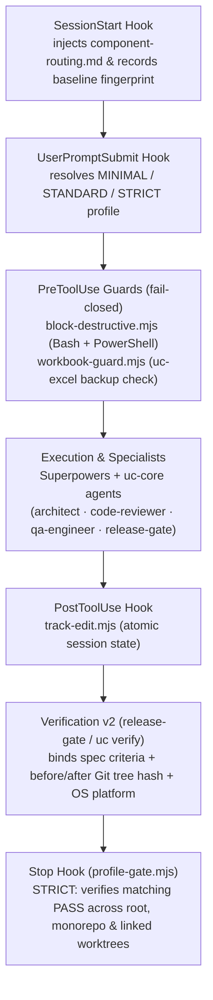

# ultimate-claude

[](https://github.com/iulian880/ultimate-claude/actions/workflows/verify.yml)


A cross-platform **Claude Code plugin marketplace** that turns AI-assisted coding from best-effort prompting into deterministic, evidence-backed engineering workflows.

Built on pure **Node.js 22** with **zero npm dependencies**, project-scoped plugins, fail-closed safety hooks, cryptographic working-tree verification, and an offline evaluation harness — verified by **176 automated tests** across Linux, macOS, and Windows.

> **Portfolio note:** published to demonstrate production-grade agent engineering — deterministic guardrails, auditable release gates, cross-platform shell parsing, and measurable component routing rather than prompt bloat. Full architecture notes: [docs/DESIGN.md](docs/DESIGN.md) (Romanian) · Repository map: [STRUCTURE.md](STRUCTURE.md).

---

## The problem — and why this beats what is on the market

Most Claude Code setups and community plugin packs fall into one of two traps: either **prompt-only rule dumps** that hope the model obeys instructions under pressure, or **global mega-bundles** that inject dozens of overlapping agents and skills into every session regardless of the task.

`ultimate-claude` takes an engineering-first approach: **enforce invariants in code, scope capabilities per project, complement existing workflows instead of cloning them, and measure routing behaviour offline.**

| Dimension | Typical prompt / rule packs | Mega-bundles (global all-in-one) | Framework alone (e.g., Superpowers) | `ultimate-claude` |
|---|---|---|---|---|
| **Destructive command safety** | Prompt advice ("don't run `rm -rf`") | Often partial or POSIX-only scripts | Not enforced at tool level | **Fail-closed `PreToolUse` hook** parsing Bash & PowerShell chains, pipes, quotes, aliases, and destructive `git` actions |
| **Release & test verification** | Self-reported prose ("tests pass") | Checklist prompts | Verification instructions | **Cryptographic v2 proof** binding acceptance criteria digest, before/after Git tree hash, verbatim command output, and OS platform |
| **Context & token discipline** | Static rules copied everywhere | Loads dozens of agents/skills globally | Single workflow profile | **Project-scoped activation** + 3 switchable rigour profiles (`MINIMAL` / `STANDARD` / `STRICT`) + compact `SessionStart` routing table |
| **Code review integrity** | Generic style feedback or soft "conditional APPROVE" | Duplicate reviews overlapping other tools | Line-level correctness review | **Distinct read-only conformance pass** (ADR, spec, rules, cross-cutting risk; confidence ≥ 80) that **returns `BLOCK` on unresolved material conditions** |
| **Domain-specific safety** | None | Generic prompts | None | **`uc-excel`** enforces fresh timestamped workbook backups before writes, protects `.xlsm` targets, and runs dedicated VBA review |
| **Measurability & regressions** | Vibes / manual spot checks | None | Manual | **Offline `stream-json` trace grader** (18 routing cases + SHA-256 bound reviews), **5 plugin evals**, and an **8-run paired A/B pilot** |
| **Runtime footprint** | N/A | Heavy install scripts / dependencies | Markdown skills | **Zero npm dependencies**, pure Node.js 22 ESM, **176 tests** in CI on Linux, macOS, and Windows |

> **Complementary by design:** `ultimate-claude` does not duplicate coding, brainstorming, TDD, or debugging flows from [Superpowers](https://github.com/obra/superpowers). It adds the missing governance layer around them — architecture decisions, conformance review, QA strategy, deterministic hooks, and auditable release proofs.

---

## Highlights

- **Fail-closed safety hooks for Bash and PowerShell.** `block-destructive.mjs` runs on `PreToolUse` (`onFailure: "block"`) and catches destructive filesystem and `git` commands even when hidden inside command chains, piped shells, quoted scripts, or PowerShell short aliases — while letting safe commands and plain text mentions through.
- **Evidence-backed `STRICT` gate (`Verification v2`).** In `STRICT` mode, closing a session after edits requires a `PASS` proof generated by `release-gate` / `uc verify` that binds three independent axes: **acceptance criteria digest** (from a Markdown spec), **exact working-tree fingerprint** (before and after checks, so checks that mutate code invalidate themselves), and **execution platform** (a LibreOffice run on macOS cannot satisfy `--platform win32`).
- **Three explicit rigour profiles.** Switch between `MINIMAL`, `STANDARD` (default), and `STRICT` per project (`env.UC_PROFILE`), from the CLI (`bin/uc strict` / `bin/uc.ps1 strict`), or mid-session by starting a prompt with `profile strict` (`profil strict`).
- **No conditional approvals.** Both `code-reviewer` and `excel-vba-reviewer` enforce a hard verdict contract: any critical/major finding or **unresolved material condition** inside the review scope returns `BLOCK` on line 1 alongside the exact evidence required to clear it — never a soft `APPROVE` with caveats buried in prose.
- **Real-world Excel/VBA protection (`uc-excel`).** Built for production corporate workbooks where corrupting a `.xlsm` is costly: `workbook-guard.mjs` blocks writes to existing workbooks in `STRICT` (and warns in `STANDARD`) unless a fresh session-local backup exists in `backups/`, while `vba-workflow` separates source edits, build/compile checks, and native Windows/Excel acceptance.
- **Measured component routing & offline evals.** At every `SessionStart` (`startup`, `resume`, `compact`, `clear`), `uc-core` injects concise evidence-based routing rules. `scripts/grade-routing.mjs` grades raw Claude Code `stream-json` captures against 18 scenarios — including zero-component direct answers (`noComponents`), `xlsx` alias normalization, and identical-prompt paired discovery tests (`discovery-gap` vs `discovery-local`) — and binds independent outcome reviews via SHA-256 capture digests.
- **Zero dependencies & multi-OS verification.** Runs directly on Node.js ≥ 22 with built-in `node:test`. Every push and PR runs all 176 unit tests, the plugin structure/frontmatter linter, `claude plugin validate`, and the native Windows PowerShell launcher in GitHub Actions across `ubuntu-latest`, `macos-latest`, and `windows-latest`.

---

## Architecture



### Marketplace plugins

| Plugin | Status | Scope | Components |
|---|---|---|---|
| **`uc-core`** | Production-ready | Per project | **Agents:** `architect`, `code-reviewer` (conformance), `qa-engineer`, `release-gate`<br>**Skills:** `complexity-check`, `product-discovery`, `delivery-report`, `uc-profile`<br>**Hooks:** `session-start`, `set-profile`, `block-destructive`, `track-edit`, `profile-gate`<br>**Evals:** 5 plugin evals (`bug-regression`, `clean-review`, `complexity-choice`, `conditional-review`, `contract-review`) |
| **`uc-excel`** | Production-ready | Per Excel/VBA project (depends on `uc-core`) | **Agent:** `excel-vba-reviewer`<br>**Skill:** `vba-workflow`<br>**Hooks:** `session-start`, `workbook-guard`<br>**Template:** `templates/excel-vba` (`.claude/settings.json`, `CLAUDE.md`, `.gitignore`) |
| **`uc-web`** | Planned ([Plan 3](STRUCTURE.md)) | Per web project | `frontend-reviewer`, `database-reviewer`, `ui-improve`, web-app template |

### Rigour profiles

| Profile | Intended use | Review & verification behaviour |
|---|---|---|
| **`MINIMAL`** | Quick spikes, small isolated edits | Lightweight flow; safety hooks (`block-destructive`) remain active |
| **`STANDARD`** *(default)* | Everyday feature and bugfix work | Superpowers correctness review + `uc-core:code-reviewer` only for distinct obligations (ADR, contract, backwards compatibility) + `delivery-report` |
| **`STRICT`** | High-risk changes, release candidates, regulated workbooks | Full conformance review + `release-gate` v2 proof bound to tree fingerprint, acceptance criteria, and platform; `Stop` hook blocks exit without matching `PASS`; `workbook-guard` hard-blocks unbacked workbook writes |

---

## Technical challenges

- **Content-based Git fingerprinting without touching `.git/index` or leaving objects behind.** Computing a working-tree hash in `plugins/uc-core/hooks/lib/fingerprint.mjs` copies the real index into a temporary directory while preserving its original `atime`/`mtime` (keeping Git's stat cache fast and "racy git" detection accurate), points `GIT_OBJECT_DIRECTORY` at a scratch directory with `info/alternates` (avoiding `:` vs `;` path-list delimiter bugs across POSIX and Windows), excludes non-code paths (`.uc/`, agent memory, specs/ADRs, nested worktrees), runs `git write-tree`, and deletes the scratch directory. Result: identical content produces the same hash before and after `git commit`, and the repository stays spotless.
- **Cross-platform destructive-command and workbook-write parsing.** Shell hooks cannot rely on naive regexes. `block-destructive.mjs` and `workbook-guard.mjs` parse chained commands, quoted paths with spaces, shell redirections (`>`, `>|`), piped shells, inline scripts, `find -delete`/`-exec`, `git checkout`/`restore`, and PowerShell aliases/named parameters (`Copy-Item`, `Remove-Item`). Backup freshness checks handle `cp -p` preserving old modification times while still rejecting backups created before the session started.
- **Parallel git worktrees and concurrent hook safety.** Edits performed in linked git worktrees remain visible to the parent session's `Stop` hook (`tests/gate-worktrees.test.mjs`), and monorepo subfolder `cd` changes still resolve proofs from the repository root. Session state updates serialize a short lock-guarded read/merge/rename cycle so concurrent hooks never observe a half-written JSON file (`tests/state.test.mjs`).
- **Tamper-resistant offline routing evaluation.** `scripts/grade-routing.mjs` invalidates any trace where `uc-core` was absent from the `system/init` event (including negative cases), separates ordinary project inspection tools (`Read`, `Grep`, `Glob`) from unnecessary specialist invocations via `noComponents`, normalizes installed skill aliases (`anthropic-skills:xlsx` → `xlsx`), and rejects outcome reviews whose `sha256` does not match the raw capture. Paired scenarios (`discovery-gap` vs `discovery-local`) use the exact same prompt and catalog while varying only whether a local project runbook exists, proving routing reacts to real project capability rather than prompt keywords.

---

## Quick start

Requires **Node.js ≥ 22** and **Claude Code**. No `npm install` needed.

### Install from the marketplace

```bash
claude plugin marketplace add "https://github.com/iulian880/ultimate-claude"
claude plugin install uc-core@ultimate-claude --scope project
```

For an Excel/VBA repository, install `uc-excel` as well (it declares `uc-core` as a dependency):

```bash
claude plugin install uc-excel@ultimate-claude --scope project
```

> **Note on `security-guidance`:** `uc-core` declares `security-guidance@claude-plugins-official` as a dependency, scoping it only to projects where `uc-core` is installed. To keep its free pattern warnings without Opus stop/commit LLM reviews, set `"ENABLE_CODE_SECURITY_REVIEW": "0"` in the project's `.claude/settings.json` `env`.
>
> **Intentional git-tracked versioning:** plugin manifests omit a static `version` field so git installs follow commits directly via `claude plugin update`, and local checkouts load straight from the working tree.

### Try without installing

Load dependencies explicitly so Claude Code satisfies the dependency graph:

```bash
claude --plugin-dir ~/.claude/plugins/cache/claude-plugins-official/security-guidance/<version> \
  --plugin-dir "/path/to/ultimate-claude/plugins/uc-core" \
  --plugin-dir "/path/to/ultimate-claude/plugins/uc-excel"
```

### Profiles and verification CLI

```bash
# Check active profile, component inventory, and latest matching PASS
./bin/uc status                # macOS / Linux
./bin/uc.ps1 status            # Windows (PowerShell)

# Launch Claude Code directly in a specific profile
./bin/uc strict
./bin/uc.ps1 strict

# Verification v2 release workflow (see docs/verification-v2.md)
./bin/uc verify --bind docs/specs/export.md
./bin/uc verify --snapshot > .uc/before.json
./bin/uc verify --capture .uc/check-1.json node --test
./bin/uc verify --record .uc/before.json .uc/report.json
./bin/uc verify --check --platform win32
```

---

## Tests, linting & evaluation

```bash
npm test                                    # 176 automated tests across 22 suites (node:test)
npm run lint                                # Plugin manifest, frontmatter & structure linter
claude plugin validate .                    # Official Claude Code marketplace validator
claude plugin validate plugins/uc-core
claude plugin validate plugins/uc-excel
```

GitHub Actions (`.github/workflows/verify.yml`) runs the full suite above on **`ubuntu-latest`**, **`macos-latest`**, and **`windows-latest`** (plus native `./bin/uc.ps1` verification on Windows).

### Offline evaluation tools

- **Component routing evaluation:** [docs/component-routing-eval.md](docs/component-routing-eval.md), [evals/component-routing.json](evals/component-routing.json) (18 cases), and [scripts/grade-routing.mjs](scripts/grade-routing.mjs).
- **8-run paired A/B pilot (Superpowers baseline vs Superpowers + UC):** [docs/pilot.md](docs/pilot.md) and [scripts/prepare-pilot.mjs](scripts/prepare-pilot.mjs).
- **Verification records & ADRs:** [docs/verification/](docs/verification/), [docs/verification-v2.md](docs/verification-v2.md), and [docs/adr/](docs/adr/).

---

## Credits

All `uc-core` and `uc-excel` agents, hooks, tests, and evaluation harnesses are original code and text. Specific review and design techniques were adapted (not copied) with attribution from:

- [anthropics/claude-plugins-official](https://github.com/anthropics/claude-plugins-official) (Apache-2.0): confidence threshold and project-rule checks in review, `file:line` evidence, implementation blueprints, criticality scores for test gaps.
- [obra/superpowers](https://github.com/obra/superpowers) (MIT): naming the failure a test catches, hand-worked expected values, mutation checks, banned hedging words in verification.
- [affaan-m/everything-claude-code](https://github.com/affaan-m/everything-claude-code) (MIT): pre-report review gate and false-positive tracking, baseline verification checks and next steps, flaky-test reruns.
- [mattpocock/skills](https://github.com/mattpocock/skills) (MIT): distinct design constraints per candidate, the deletion test, dependency classes, and the three-part ADR test.
